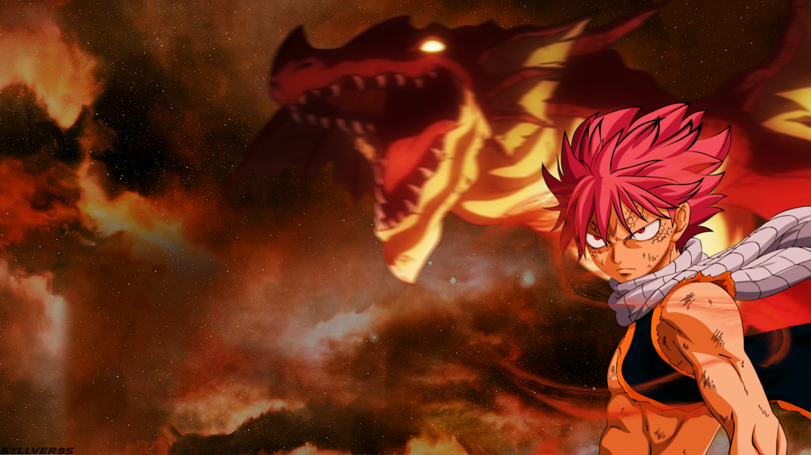
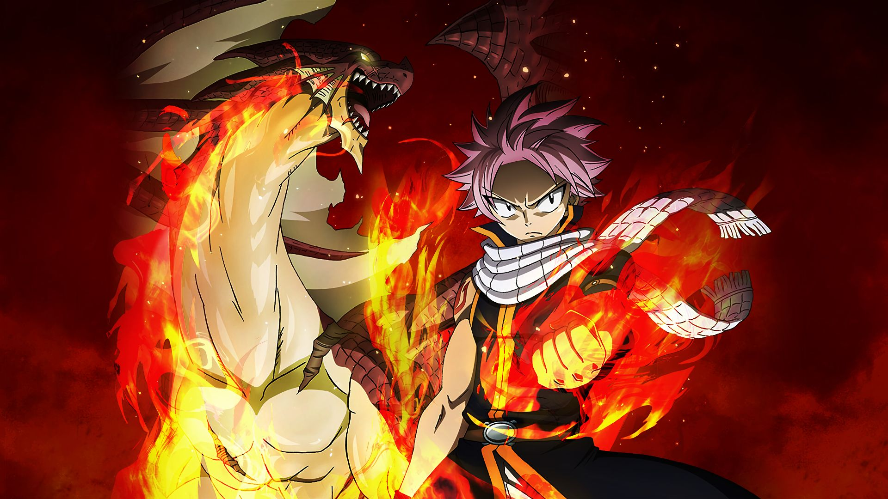
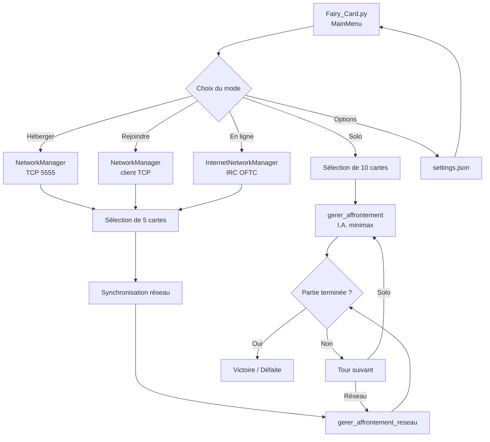

<div align="center">

# 🧚 Fairy Card

**Un jeu de cartes de combat tactique inspiré de l'univers de Fairy Tail.**
Affrontez l'I.A. ou défiez un joueur en réseau local, capturez ses mages et faites basculer le destin du champ de bataille.

[](https://www.python.org/)
[](https://www.pygame.org/)
[]()
[]()
[](#-licence-et-avertissement)
[]()

*Projet de fan, non commercial et non affilié à Hiro Mashima, Kōdansha ou aux ayants droit de Fairy Tail.*

</div>

---

## 📖 Sommaire

- [Aperçu](#-aperçu)
- [Présentation](#-présentation)
- [Fonctionnalités](#-fonctionnalités)
- [Règles du jeu](#-règles-du-jeu)
- [Le roster](#-le-roster)
- [Cartes spéciales](#-cartes-spéciales)
- [Installation](#-installation)
- [Lancement](#-lancement)
- [Commandes](#-commandes)
- [Multijoueur](#-multijoueur)
- [Options et configuration](#-options-et-configuration)
- [Architecture du projet](#-architecture-du-projet)
- [Créer un exécutable](#-créer-un-exécutable)
- [Dépannage](#-dépannage)
- [Limites connues](#-limites-connues)
- [Feuille de route](#-feuille-de-route)
- [Contribuer](#-contribuer)
- [Licence et avertissement](#-licence-et-avertissement)
- [Crédits](#-crédits)

---

## 🎬 Aperçu

<div align="center">



*Arrière-plan de l'écran d'accueil (thème par défaut)*

</div>

Trois thèmes d'arrière-plan sont fournis et sélectionnables depuis les options :

| Thème 1 | Thème 2 | Thème 3 |
|:--:|:--:|:--:|
|  |  |  |

> 💡 Les visuels ci-dessus présentent les arrière-plans fournis. Des captures de gameplay pourront être ajoutées dans `docs/` pour illustrer le README.

---

## 🧭 Présentation

**Fairy Card** est un jeu de cartes au tour par tour développé en **Python avec pygame**. Chaque joueur constitue une équipe de mages issus de l'univers de Fairy Tail, puis les deux camps s'affrontent carte contre carte.

Le cœur du jeu repose sur un principe simple mais impitoyable : **une carte affaiblie peut changer de camp**. Une carte dont les PV passent sous zéro est capturée par l'adversaire, soignée et renforcée. Chaque échange peut donc retourner la partie — vous ne perdez pas seulement un combattant, vous offrez un soldat à l'ennemi.

Le jeu propose :

- un **mode solo** contre une I.A. qui utilise un **minimax avec élagage alpha-bêta** ;
- un **mode multijoueur en réseau local** (hôte / client, TCP) ;
- un **matchmaking en ligne** sans serveur dédié, via IRC ;
- un système de **cartes spéciales**, un mode **Éveil** et des mises en scène animées ;
- une interface **bilingue français / anglais**, entièrement personnalisable.

Le projet représente environ **4 000 lignes de Python** réparties en quatre modules, sans aucune dépendance autre que `pygame`.

---

## ✨ Fonctionnalités

### Gameplay

- 🃏 **63 personnages jouables** répartis en 5 archétypes (boss, tanks, glass cannons, combattants équilibrés, supports).
- ⚔️ **Combats simultanés** : les deux joueurs choisissent une carte en secret, puis les cartes s'entrechoquent.
- 🔄 **Capture** : une carte à PV négatifs rejoint le camp adverse avec un bonus de PV et d'ATK.
- 🎲 **Mélange synchronisé** des decks après chaque round en multijoueur.
- ✨ **7 cartes spéciales** tirées aléatoirement (2 par joueur et par partie).
- 🔥 **Mode Éveil** : un boost de dernier recours, puissant mais épuisant.
- 🤖 **I.A. tactique** : minimax profondeur 5, élagage alpha-bêta, évaluation PV + 2 × ATK et choix pondéré parmi les 3 meilleurs coups.

### Interface et audio

- 🖥️ Affichage **plein écran** adapté à la résolution du bureau.
- 🎞️ Animations d'affichage des cartes, flip, impact, screen shake, textes flottants et particules.
- 🎨 **Effets glassmorphism**, néons, halos et dégradés dessinés à la volée.
- 🖱️ Carrousel de sélection avec défilement automatique, survol zoomé et fiche technique dynamique.
- 🔊 **Effets sonores générés proceduralement** au premier lancement (WAV synthétisés en Python).
- 🌍 **Interface FR / EN**, volumes musique et SFX, luminosité, choix du thème.

### Réseau

- 🏠 **Hébergement LAN** en un clic, avec affichage de l'adresse IP locale.
- 🔗 **Connexion par IP**, saisie directe au clavier.
- 🌐 **Matchmaking en ligne** via le réseau IRC (OFTC), sans serveur à héberger.
- 🔁 **États synchronisés** : sélection des decks, cartes spéciales, Éveil, coups joués et mélanges.

---

## 📜 Règles du jeu

### Mise en place

| Mode | Deck du joueur | Deck adverse |
|---|---|---|
| **Solo** | les **5 premières** cartes sélectionnées | les **5 suivantes** (contrôlées par l'I.A.) |
| **Multijoueur** | 5 cartes choisies | 5 cartes choisies par l'adversaire |

En solo, vous composez donc **10 cartes** : les cinq premières forment votre équipe, les cinq dernières constituent l'équipe que l'I.A. pilotera. Choisissez-les avec soin… pour vous comme contre vous.

### Déroulement d'un tour

1. Chaque joueur choisit **secrètement** une carte de son deck.
2. Les deux cartes sont révélées et entrent en collision.
3. Chaque carte perd des PV égaux à l'**ATK de la carte adverse** (sauf si un bouclier absorbe le coup).
4. Les deux cartes perdent **20 % de leur propre ATK** (arrondi à l'entier inférieur) : les combats s'essoufflent.
5. En multijoueur, les decks sont **mélangés de façon synchrone** avant le tour suivant (l'hôte tire l'ordre et le transmet). En solo, l'ordre reste inchangé.

### Capture et élimination

| Situation | Conséquence |
|---|---|
| PV < 0 | La carte est **capturée** : PV = \|PV\| + 200, ATK + 100, et elle rejoint le camp adverse. |
| PV = 0 **ou** ATK ≤ 0 | La carte est **détruite** définitivement. |

### Condition de victoire

> **Vous gagnez lorsque le deck adverse est vide.** Vous perdez lorsque le vôtre l'est.

Il n'y a pas de points de vie de joueur : toute la partie se joue sur la survie de votre équipe.

### Mode Éveil

L'Éveil est un **atout unique**, activable depuis un bouton dédié lorsqu'il est disponible, c'est-à-dire lorsque :

- vous avez **3 cartes ou moins** et **moins de cartes que l'adversaire** ; ou
- il ne vous reste **qu'une seule carte**.

Effets :

- toutes vos cartes gagnent **+800 PV** et **+300 ATK** ;
- l'état dure **3 tours** ;
- à la fin, **épuisement** : chaque carte éveillée perd **450 ATK** (minimum 50) et **500 PV** (minimum 100).

L'I.A. dispose du même Éveil et le déclenche automatiquement dès que la condition est remplie.

---

## 🧙 Le roster

**63 mages**, chacun avec ses PV et son ATK. Les profils sont pensés pour créer des choix cornéliens : une carte puissante est aussi une carte dangereuse à laisser capturer.

### Boss suprêmes / Classe S — 10 personnages

| Personnage | PV | ATK |
|---|---:|---:|
| Acnologia | 3000 | 500 |
| Zeleph | 2850 | 480 |
| Ignir | 2950 | 495 |
| Gildart | 2900 | 490 |
| August | 2800 | 450 |
| Eileen | 2700 | 440 |
| MardGheer | 2700 | 430 |
| Zeros | 2750 | 460 |
| Larcade | 2600 | 410 |
| Weisslogia | 2800 | 380 |

### Tanks / Protecteurs — 9 personnages

| Personnage | PV | ATK |
|---|---:|---:|
| Makarof | 2700 | 220 |
| Jura | 2600 | 200 |
| Metalicana | 2800 | 210 |
| Elfman | 2400 | 220 |
| Grandinet | 2500 | 200 |
| Azuma | 2450 | 210 |
| Freed | 2350 | 220 |
| Bicksrow | 2300 | 230 |
| Jose | 2400 | 215 |

### Glass cannons / Assassins — 10 personnages

| Personnage | PV | ATK |
|---|---:|---:|
| Ikaruga | 1200 | 490 |
| Jackal | 1250 | 480 |
| Seila | 1280 | 470 |
| Kyoka | 1320 | 465 |
| Midnight | 1300 | 460 |
| Cobra | 1350 | 450 |
| Tempester | 1300 | 450 |
| Keith | 1300 | 440 |
| Bora | 1150 | 430 |
| Ezer | 1380 | 440 |

### Combattants équilibrés — 19 personnages

| Personnage | PV | ATK |
|---|---:|---:|
| Natsu | 2000 | 380 |
| Luxus | 2050 | 390 |
| Erza | 2100 | 370 |
| Jellal | 1980 | 375 |
| Grey | 1950 | 360 |
| Mirajane | 1900 | 365 |
| Gajil | 2050 | 350 |
| Silver | 2000 | 360 |
| Sting | 1900 | 350 |
| Rogue | 1900 | 350 |
| Oul | 1950 | 340 |
| Leon | 1850 | 330 |
| Kagura | 1900 | 360 |
| Minerva | 1950 | 370 |
| Backus | 1800 | 340 |
| Orga | 1850 | 350 |
| Blunote | 2100 | 390 |
| Di_maria | 1800 | 360 |
| Hades | 2650 | 420 |

### Supports / Tacticiens — 15 personnages

| Personnage | PV | ATK |
|---|---:|---:|
| Lucy | 1650 | 210 |
| Mavis | 1700 | 220 |
| Wendy | 1600 | 180 |
| Cherrya | 1550 | 190 |
| Leo | 1700 | 250 |
| Kanna | 1650 | 240 |
| Aria | 1500 | 230 |
| Mest | 1600 | 220 |
| Melty | 1550 | 200 |
| Yukino | 1500 | 200 |
| Eligoal | 1600 | 260 |
| Reby | 1450 | 170 |
| Jenny | 1500 | 180 |
| Ichiya | 1400 | 160 |
| Juvia | 1750 | 250 |

> Les statistiques sont définies dans la liste `card_data` de [`Fairy_Card.py`](Fairy_Card.py). Les portraits se trouvent dans `Image/<Nom>.jpg`.

---

## 🎴 Cartes spéciales

Au début de chaque partie, **2 cartes spéciales** sont tirées au hasard parmi 7 (les doublons sont possibles) pour chaque joueur. Elles s'utilisent à tout moment pendant votre tour, puis disparaissent.

| # | Carte | Effet | Cible |
|:-:|---|---|---|
| 1 | **Soin Lacryma** | +800 PV | Allié |
| 2 | **Bouclier Erza** | Annule les prochains dégâts subis (un clash) | Allié |
| 3 | **Rage Dragon** | +250 ATK permanents | Allié |
| 4 | **Origine Secondaire** | +400 ATK / −300 PV (PV minimum : 100) | Allié |
| 5 | **Portail Éclipse** | Échange les PV de l'allié ciblé avec ceux de l'ennemi ayant le plus de PV | Allié |
| 6 | **Loi des Fées** | −300 PV à toutes les cartes ennemies | Toutes les cartes ennemies |
| 7 | **Sceau de Zeleph** | −50 % d'ATK permanents (ATK minimum : 50) | Ennemi |

Les effets sont appliqués par `apply_spell_effect()` dans [`Confrontation.py`](Confrontation.py). En multijoueur, chaque sort est transmis à l'adversaire pour maintenir les deux plateaux cohérents.

---

## 🚀 Installation

### Prérequis

- **Python 3.8 ou supérieur**
- **pygame 2.x**
- Une résolution d'écran suffisante (le jeu passe en plein écran et utilise la résolution du bureau)
- Un clavier et une souris

### Étapes

```bash
# 1. Cloner le dépôt
git clone https://github.com/<votre-utilisateur>/Fairy-Card.git
cd Fairy-Card

# 2. Créer un environnement virtuel (recommandé)
python -m venv .venv

# Windows
.venv\Scripts\activate
# Linux / macOS
source .venv/bin/activate

# 3. Installer la seule dépendance
pip install pygame

# 4. Lancer le jeu
python Fairy_Card.py
```

Un fichier `requirements.txt` minimal peut être créé avec :

```txt
pygame>=2.0.0
```

### 🎵 Musiques d'ambiance requises

Le code charge deux pistes qui **ne sont pas incluses dans le dépôt** :

| Fichier attendu | Utilisation |
|---|---|
| `Sound/Background(1).mp3` | musique des menus et de la sélection |
| `Sound/Background.mp3` | musique des combats |

Sans ces fichiers, `pygame.mixer.music.load()` lève une erreur et le jeu ne démarre pas. Ajoutez vos propres pistes (libres de droits) avec exactement ces noms, ou adaptez les appels dans `Fairy_Card.py` et `Confrontation.py`.

Les **effets sonores** (`ui_click`, `ui_hover`, `card_select`, `clash_impact`, `special_activate`, `shuffle`) sont, eux, générés automatiquement au premier lancement par `generate_game_sounds()` si les `.wav` sont absents.

---

## 🕹️ Lancement

```bash
python Fairy_Card.py
```

Le point d'entrée lance `MainMenu()`, puis :

- **Jouer contre l'I.A.** → sélection de 10 cartes → affrontement solo ;
- **Matchmaking en ligne** → connexion automatique à l'IRC → recherche d'adversaire ;
- **Héberger une partie** → ouverture du port **5555** et affichage de l'IP locale ;
- **Rejoindre une partie** → saisie de l'IP de l'hôte ;
- **Options** → audio, luminosité, langue, thèmes et règles ;
- **Quitter** → fermeture du jeu.

> Le mode solo est entièrement hors ligne. Une connexion Internet n'est nécessaire que pour le matchmaking en ligne.

---

## ⌨️ Commandes

| Contexte | Action | Commande |
|---|---|---|
| Menus | Naviguer | Souris |
| Menus | Revenir en arrière / quitter | `Échap` |
| Sélection | Faire défiler le carrousel | `←` / `→` (maintenir pour accélérer) |
| Sélection | Ajouter / retirer une carte | Clic gauche |
| Sélection | Désélectionner une carte recrutée | Clic sur sa miniature |
| Connexion | Saisir une adresse IP | Chiffres, `.`, `Retour arrière` |
| Connexion | Valider | `Entrée` |
| Combat | Attaquer avec une carte | Clic sur une carte de son camp |
| Combat | Lancer un sort | Clic sur la carte spéciale, puis sur la cible |
| Combat | Activer l'Éveil | Clic sur le bouton 🔥 **ÉVEIL** 🔥 |
| Combat | Quitter | Bouton **Quitter** |

---

## 🌐 Multijoueur

### Option A — Réseau local (LAN)

1. Le joueur 1 clique sur **Héberger une partie**.
2. Le jeu affiche son **adresse IP locale**, par exemple `192.168.1.42`.
3. Le joueur 2 clique sur **Rejoindre une partie**, saisit cette IP et appuie sur `Entrée`.
4. Les deux joueurs choisissent 5 cartes, puis la partie démarre.

**Détails techniques**

- Protocole : **TCP**, port **5555**.
- Format : **JSON délimité par des retours à la ligne** (`\n`).
- L'hôte écoute sur `0.0.0.0:5555` ; le client se connecte avec un timeout de 5 s.
- Les échanges passent par deux threads (accept/connect et réception) et une `queue.Queue` lue par la boucle de jeu.

> Si la connexion échoue, vérifiez le pare-feu de la machine hôte (autoriser le port 5555 en entrée) et assurez-vous que les deux machines sont sur le même réseau (ou le même VPN).

### Option B — Matchmaking en ligne (IRC)

Aucun serveur de jeu à héberger : les deux clients se rencontrent sur un canal IRC public. Aucun port entrant n'est à ouvrir, tout passe par une connexion sortante vers l'IRC.

| Paramètre | Valeur |
|---|---|
| Serveur | `irc.oftc.net` |
| Port | `6667` |
| Canal | `#fairy_card_matchmaking_lobby` |
| Pseudo | `Fairy_<identifiant aléatoire>` |

**Fonctionnement**

1. Le client se connecte à l'IRC et rejoint le canal.
2. Toutes les 2,5 s, il diffuse `FC_SEARCH_<id>`.
3. Le client avec le **plus grand identifiant** propose un match par message privé : `FC_PROPOSE_<proposeur>_<cible>`.
4. La cible accepte avec `FC_ACCEPT_<accepteur>_<proposeur>` ; le plus petit identifiant devient l'hôte.
5. Les messages de jeu sont ensuite relayés en messages privés, encodés en Base64 : `FC_DATA_<json_base64>`.
6. `FC_QUIT` signale une déconnexion.

### Protocole applicatif

| Message | Émetteur | Rôle |
|---|---|---|
| `selection` | Les deux | Envoie la liste des noms de cartes choisies |
| `play_card` | Les deux | Annonce l'index de la carte jouée |
| `init_specials` | Hôte | Distribue les cartes spéciales des deux joueurs |
| `play_special` | Les deux | Sort joué, cible et camp de la cible |
| `activate_eveil` | Les deux | Active l'Éveil |
| `shuffle` | Hôte | Ordres de mélange synchronisés des deux decks |
| `disconnected` | Interne | L'adversaire a quitté ou la connexion a été perdue |
| `connected` | Interne | Connexion établie |
| `connection_failed` | Interne | Échec de connexion |

> 🔒 **Sécurité** : le matchmaking IRC circule en clair, sans chiffrement ni authentification, et chaque client fait autorité sur son propre état. Ce mode est adapté à des parties amicales, **pas** à un usage compétitif ou à des inconnus. Pour jouer sereinement, préférez le LAN.

---

## ⚙️ Options et configuration

Les préférences sont sauvegardées automatiquement dans `settings.json`, dans le dossier du script (ou dans le dossier temporaire de l'exécutable PyInstaller).

| Clé | Type | Valeur par défaut | Description |
|---|---|---|---|
| `volume_music` | float `0.0 – 1.0` | `0.5` | Volume de la musique |
| `volume_sfx` | float `0.0 – 1.0` | `0.5` | Volume des effets sonores |
| `language` | `"fr"` / `"en"` | `"fr"` | Langue de l'interface |
| `bg_image` | chaîne | `"Home_screen.jpeg"` | Thème d'arrière-plan |
| `brightness` | float `0.2 – 1.0` | `1.0` | Luminosité simulée par un voile noir |
| `mute` | booléen | `false` | Coupe tous les sons |

Les textes sont centralisés dans le dictionnaire `LOCALIZATION` de [`Customize_home_screen.py`](Customize_home_screen.py) : ajouter une langue revient à ajouter une entrée et un bouton dans `draw_language_selector()`.

---

## 🏗️ Architecture du projet

```text
Fairy-Card/
├── Fairy_Card.py              # Point d'entrée : menu, sélection, options, salons réseau
├── Confrontation.py           # Moteur de combat solo + réseau, I.A., animations, sorts
├── Customize_home_screen.py   # Cartes, particules, réglages, localisation, audio, widgets
├── NetworkManager.py          # LAN TCP (hôte/client) + matchmaking IRC
├── build_exe.spec             # Recette PyInstaller
├── settings.json              # Préférences utilisateur persistées
├── Fonts/
│   └── anime-ace.regular.ttf  # Police de toute l'interface
├── Image/
│   ├── Card_Back.png          # Dos de carte
│   ├── Home_screen*.jpeg      # Thèmes d'accueil
│   └── <Personnage>.jpg       # 63 portraits
└── Sound/
    ├── *.wav                  # Effets sonores (régénérables)
    ├── natsu.mp3, Lucy.mp3    # Présents mais non utilisés par le code actuel
    └── Background*.mp3        # Musiques (à fournir)
```

### Flux d'exécution



### Détail des modules

| Fichier | Lignes | Responsabilités |
|---|---:|---|
| `Fairy_Card.py` | ~1 160 | Boucle du menu principal, carrousel et fiche technique, options à onglets, salons d'attente, boutons glassmorphism, fondus. |
| `Confrontation.py` | ~1 813 | Résolution des combats, animations (slide, flip, clash, screen shake), I.A. minimax, cartes spéciales, Éveil, affrontement réseau et mélange synchronisé. |
| `Customize_home_screen.py` | ~643 | Classe `Card`, particules, texte flottant, `SettingsManager`, localisation FR/EN, génération WAV, sliders et sélecteurs. |
| `NetworkManager.py` | ~432 | Serveur/client LAN en TCP, matchmaking IRC, file de messages, protocole JSON. |

### Choix d'implémentation notables

- **Une seule dépendance** : `pygame`. Aucun framework, aucun asset externe obligatoire hormis les images et la police.
- **Effets sonores procéduraux** : les `.wav` sont synthétisés avec `wave` et `struct` (sinusoïdes, bruit, enveloppes) au lieu d'être versionnés.
- **UI dessinée à la volée** : panneaux, néons, barres de statistiques et halos sont générés avec les primitives pygame, sans images d'interface.
- **Réseau non bloquant côté boucle de jeu** : les threads réseau déposent les messages dans une file ; la boucle principale les consomme à chaque frame.
- **Hôte autoritaire pour l'aléatoire partagé** : distribution des sorts et ordre de mélange sont décidés par l'hôte puis transmis au client.
- **Résolution dynamique** : toutes les positions sont calculées à partir de `pygame.display.Info()`, ce qui évite de figer une taille de fenêtre.

---

## 📦 Créer un exécutable

Le fichier `build_exe.spec` est prêt pour **PyInstaller**.

```bash
pip install pyinstaller
pyinstaller build_exe.spec
```

Résultat :

- `dist/Fairy_Card` (Linux / macOS) ou `dist/Fairy_Card.exe` (Windows) ;
- les dossiers `Image/`, `Sound/`, `Fonts/` et `settings.json` sont embarqués ;
- `console=False` : aucune console ne s'ouvre au lancement.

**Personnaliser l'icône** : dans `build_exe.spec`, remplacez `icon=None` par :

```python
icon='Image/Fleche.ico',
```

> Lancez toujours PyInstaller depuis la racine du projet. Les chemins d'accès aux assets sont résolus via `sys._MEIPASS` dans `normalize_path()`, ce qui rend l'exécutable autonome.

---

## 🩺 Dépannage

| Symptôme | Cause probable | Solution |
|---|---|---|
| `pygame.error: Couldn't open Sound/Background(1).mp3` | Musiques absentes | Ajoutez les deux `.mp3` attendus (voir [Musiques requises](#-musiques-dambiance-requises)). |
| `ModuleNotFoundError: No module named 'pygame'` | Dépendance non installée | `pip install pygame` (dans l'environnement virtuel activé). |
| Le jeu s'ouvre mais aucun son | Mixer non initialisé / périphérique absent | Vérifiez la sortie audio et lancez le jeu depuis un terminal pour lire les avertissements de `pygame.mixer`. |
| L'écran est mal cadré | Résolution ou mise à l'échelle du système | Le jeu utilise la résolution native du bureau ; vérifiez la résolution et le facteur de mise à l'échelle de l'OS. |
| Les boutons ne réagissent pas | Fenêtre non focalisée / plein écran | Cliquez dans la fenêtre, puis utilisez `Échap` pour revenir au menu. |
| Connexion LAN impossible | Port 5555 bloqué | Autorisez le port dans le pare-feu de l'hôte, vérifiez le réseau et l'IP saisie. |
| Le matchmaking reste bloqué | Port 6667 sortant bloqué | Essayez un autre réseau ou utilisez le mode LAN. |
| `Error loading settings` | `settings.json` corrompu | Supprimez le fichier : il sera recréé avec les valeurs par défaut. |
| L'exécutable ne trouve pas les images | Build lancé hors racine ou assets déplacés | Relancez `pyinstaller build_exe.spec` depuis la racine du projet. |

---

## ⚠️ Limites connues

- **Musiques absentes du dépôt** : `Background(1).mp3` et `Background.mp3` doivent être fournies pour que le jeu démarre.
- **Pas de mode fenêtré** : l'affichage est systématiquement en plein écran à la résolution du bureau.
- **Réseau en clair** : ni chiffrement, ni authentification, ni serveur autoritaire ; la triche et la désynchronisation restent possibles.
- **Validation d'IP minimale** : la saisie n'accepte que chiffres et points, sans vérifier le format complet.
- **Textes résiduels en français** dans le HUD de combat (`Quitter`, `VOUS`, `ADVERSAIRE`, `You Win` / `You Lose`, `MELANGE DES CARTES...`) même lorsque l'interface est en anglais.
- **Réglages non persistants en version compilée** : `settings.json` est localisé via `__file__`, qui pointe vers le dossier temporaire `_MEIPASS` dans un exécutable PyInstaller ; les préférences peuvent donc être perdues à la fermeture.
- **Pas de sauvegarde de partie** ni de statistiques persistantes.
- **Doublons de cartes spéciales** possibles (deux exemplaires de la même carte).
- **Pas de tests automatisés** pour l'instant.

---

## 🗺️ Feuille de route

- [ ] Ajouter `requirements.txt` et un workflow CI minimal.
- [ ] Fournir des musiques libres de droits ou générer une ambiance procédurale.
- [ ] Remplacer le matchmaking IRC par un serveur dédié (WebSocket/TLS) avec état autoritaire.
- [ ] Mode fenêtré et résolutions configurables.
- [ ] Externaliser tous les textes du HUD pour un FR/EN complet.
- [ ] Tests unitaires du moteur de combat (capture, Éveil, sorts).
- [ ] Écran de résultats avec statistiques de partie.
- [ ] Support des manettes et des raccourcis clavier configurables.
- [ ] Refactorisation en package Python (`fairy_card/`) avec séparation rendu / logique.
- [ ] Captures d'écran et GIF de démonstration dans le README.

---

## 🤝 Contribuer

Les contributions sont les bienvenues, en particulier pour la traduction, l'équilibrage et la refactorisation.

1. **Forkez** le dépôt.
2. Créez une branche descriptive :

   ```bash
   git checkout -b feat/matchmaking-tls
   ```

3. Gardez le style existant : code lisible, noms explicites, commentaires utiles (le projet mélange volontairement français et anglais dans le code).
4. Testez au minimum : un duel solo complet, une partie LAN et le passage FR → EN.
5. Ouvrez une **Pull Request** en décrivant le problème et la solution.

### Signaler un bug

Merci d'indiquer :

- votre OS et votre version de Python / pygame ;
- le mode de jeu concerné (solo, LAN, en ligne) ;
- les étapes de reproduction ;
- le message d'erreur complet de la console ;
- une capture d'écran si c'est visuel.

---

## ⚖️ Licence et avertissement

### Code

Le code source de ce projet est distribué sous **licence MIT** (voir le fichier [LICENSE](LICENSE)). Vous êtes libre de l'utiliser, de le modifier et de le redistribuer, y compris à des fins commerciales, à condition de conserver la notice de copyright.

```text
MIT License — Copyright (c) 2026 Fairy Card contributors
```

### Propriété intellectuelle Fairy Tail

**Fairy Card est un projet de fan, non commercial et non officiel.** *Fairy Tail*, ses personnages, ses noms et son univers sont la propriété de **Hiro Mashima**, **Kōdansha** et de leurs ayants droit respectifs. Les portraits, noms de personnages et éléments visuels inspirés de l'œuvre sont utilisés à des fins de démonstration et d'hommage.

Cette licence MIT **ne couvre pas** les éléments issus de la franchise. Si vous êtes ayant droit et souhaitez le retrait d'un contenu, ouvrez une issue : le contenu concerné sera retiré rapidement.

Ce dépôt inclut des visuels de personnages issus de l'œuvre. Leur présence ne constitue ni une autorisation de réutilisation ni un transfert de droits. Si vous rediffusez ce projet, vérifiez vos droits ou remplacez ces visuels par des créations originales ou libres de droits, et restez prudent quant à l'usage des musiques.

---

## 🙏 Crédits

- **Développement** : projet personnel de fan, réalisé en Python avec [pygame](https://www.pygame.org/).
- **Univers et personnages** : *Fairy Tail* de **Hiro Mashima**.
- **Police** : `anime-ace.regular.ttf`.
- **Inspirations** : jeux de cartes à collectionner et mécaniques de capture.
- **Communauté pygame** pour sa documentation et ses exemples.

---

<div align="center">

**Que la magie des fées guide vos cartes.** ✨

⭐ Si le projet vous plaît, laissez une étoile sur le dépôt !

</div>
